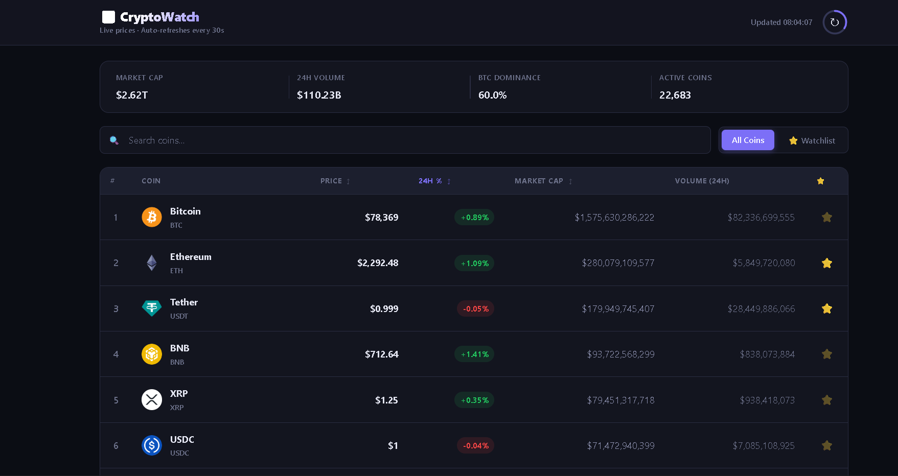

# 07 — CryptoWatch 📈

> A real-time cryptocurrency dashboard built with vanilla JavaScript.
>
> Track crypto prices, search coins, sort market data, manage a watchlist, and view detailed coin information.
>
> Built with Fetch API, async/await, Promise.all(), localStorage, and a 6-layer architecture.
>
> No frameworks. Pure JS.

## 🎯 What I Built

A cryptocurrency dashboard powered by the **CoinGecko API**.

The dashboard loads the top 20 cryptocurrencies by market capitalization and displays their prices, 24-hour price changes, market caps, and trading volumes.

Users can search for coins, sort market data, add coins to a personal watchlist, and click any coin to view more detailed information in a modal.

The dashboard also displays global cryptocurrency market statistics, including total market capitalization, 24-hour trading volume, Bitcoin dominance, and the number of active cryptocurrencies.

Market data refreshes automatically every 30 seconds, with a manual refresh button and a visual countdown ring.

## ✨ Features

* [x] Live cryptocurrency prices — fetches the top 20 coins by market capitalization
* [x] Global market statistics — market cap, 24-hour volume, BTC dominance, and active coins
* [x] Auto-refresh — updates market data every 30 seconds
* [x] Manual refresh — refresh market data with one click
* [x] Refresh countdown ring — visual indicator for the refresh interval
* [x] Search coins — filter cryptocurrencies by name as you type
* [x] Sortable columns — sort by price, 24-hour change, and market cap
* [x] Watchlist — add or remove favorite coins
* [x] LocalStorage — saves the watchlist across page reloads
* [x] Coin detail modal — displays price, market cap, volume, 24-hour high and low, circulating supply, and all-time high
* [x] Coin descriptions — fetches detailed information from the API
* [x] Read More — expand and collapse coin descriptions
* [x] Price change animations — highlights price increases and decreases after refreshing
* [x] Toast notifications — displays success and error messages
* [x] Loading and empty states — provides feedback while loading or when no coins match
* [x] Responsive design — adapts the dashboard to smaller screens

## 🧠 JS Concepts Used

### Async & APIs

* **Fetch API** — retrieves cryptocurrency prices, global statistics, and coin details from CoinGecko.
* **async/await** — handles asynchronous API requests in a readable way.
* **Promise.all()** — fetches coin data and global market statistics concurrently.
* **Error Handling** — checks HTTP responses and uses try/catch to handle failed requests.
* **JSON** — converts API responses into JavaScript objects for use in the application.

### DOM & Events

* **DOM Manipulation** — dynamically creates table rows and updates market statistics.
* **Event Delegation** — handles watchlist clicks and coin selection through a single listener on the table body.
* **Array Methods** — uses `filter()`, `find()`, `includes()`, and `forEach()` to manage coin data.
* **Spread Operator** — copies the coin array before sorting or preserving previous prices.
* **Template Literals** — generates cryptocurrency table rows dynamically.
* **Conditional Rendering** — displays different empty states depending on the active view and search query.

### State & Browser APIs

* **Centralized State** — stores coin data, watchlist IDs, search query, active tab, and sorting preferences in one object.
* **localStorage** — persists the watchlist between page reloads.
* **setInterval()** — automatically refreshes market data every 30 seconds.
* **clearInterval()** — resets the automatic refresh timer when manual refresh is triggered.
* **requestAnimationFrame()** — starts the refresh ring animation at the appropriate time.
* **Date API** — displays the time of the most recent successful update.

### Architecture & Performance

* **6-Layer Architecture** — separates DOM caching, state/configuration, utilities, API requests, UI rendering, and application management.
* **Separation of Concerns** — keeps data fetching separate from rendering and event handling.
* **State-Driven Rendering** — filters and sorts data based on the current application state.
* **CSS Animations** — highlights price movements and animates loading indicators and modals.
* **Responsive CSS** — adjusts the table, statistics, controls, and modal for different screen sizes.

## 🏗️ Architecture

```text
app.js
│
├── 1. DOM Elements Cache
│   ├── Header and refresh controls
│   ├── Global market statistics
│   ├── Search input and tabs
│   ├── Cryptocurrency table
│   ├── Loading and empty states
│   ├── Coin detail modal
│   └── Toast notifications
│
├── 2. State & Config
│   ├── BASE_URL
│   └── state
│       ├── coins
│       ├── watchlist
│       ├── sortBy
│       ├── sortDir
│       ├── query
│       ├── tab
│       ├── intervalId
│       └── abortCtrl
│
├── 3. Utilities
│   ├── showToast()
│   ├── formatLarge()
│   ├── updateLastUpdated()
│   └── animateRing()
│
├── 4. API Layer
│   ├── fetchTopCoins()
│   ├── fetchGlobalStats()
│   └── fetchCoinDetails(coinId)
│
├── 5. UI Controller
│   ├── renderTable(coins, oldCoins)
│   ├── renderGlobalStats(data)
│   ├── renderCurrentView()
│   ├── openModal(coinId)
│   └── Modal and description controls
│
└── 6. Manager & Listeners
    ├── Search input
    ├── Watchlist interactions
    ├── Sortable table headers
    ├── All Coins / Watchlist tabs
    ├── Manual refresh button
    ├── Automatic refresh interval
    └── init()
        ├── Restore watchlist from localStorage
        ├── Fetch initial coin data
        ├── Fetch global market statistics
        ├── Render the dashboard
        └── Start automatic refresh
```

## 🔄 Data Flow

### Initial Load & Auto-Refresh

```text
User opens CryptoWatch
        ↓
init()
        ↓
Restore watchlist from localStorage
        ↓
Promise.all()
        │
        ├── fetchTopCoins()
        │       ↓
        │   CoinGecko Markets API
        │
        └── fetchGlobalStats()
                ↓
            CoinGecko Global API
        ↓
Store coin data in state.coins
        ↓
Render cryptocurrency table
        ↓
Render global market statistics
        ↓
Update last-updated time
        ↓
startAutoRefresh()
        ↓
Wait 30 seconds
        ↓
refresh()
        ↓
Fetch fresh coin data and global statistics
        ↓
Compare previous and current prices
        ↓
Highlight price increases or decreases
        ↓
Update the table and statistics
        ↓
Repeat every 30 seconds
```

### Search, Sorting & Watchlist

```text
User interacts with the dashboard
        │
        ├── Search
        │     ↓
        │   Update state.query
        │
        ├── Sort
        │     ↓
        │   Update state.sortBy and state.sortDir
        │
        └── Watchlist
              ↓
            Add or remove coin ID
              ↓
            Save watchlist to localStorage
        ↓
renderCurrentView()
        ↓
Copy state.coins into a new array
        ↓
Apply active watchlist filter
        ↓
Apply search filter
        ↓
Apply sorting
        ↓
Render the matching coins
        ↓
DOM reflects the current state
```

### Coin Details Modal

```text
User clicks a cryptocurrency row
        ↓
openModal(coinId)
        ↓
Find the coin in state.coins
        ↓
Display existing market information
        ↓
fetchCoinDetails(coinId)
        ↓
CoinGecko returns detailed coin data
        ↓
Display the coin description
        ↓
User can expand or collapse the description
        ↓
Close modal using the close button,
outside click, or Escape key
```

## 💡 What I Learned

* **Promise.all() improves loading efficiency.** Coin market data and global statistics are independent requests, so they can run concurrently instead of waiting for one another.

* **State makes the UI easier to manage.** Keeping the coin data, search query, active tab, and sorting preferences in one object makes it easier to determine what should be displayed.

* **Filtering and sorting should operate on a copy.** Using the spread operator to create a new array prevents sorting from directly changing the original array stored in state.

* **Event Delegation works well with dynamic content.** Cryptocurrency rows and watchlist buttons are generated dynamically, so one listener on the table body can handle their interactions.

* **localStorage makes the watchlist persistent.** Saving coin IDs as JSON allows the application to restore the user's watchlist after a page reload.

* **setInterval() enables automatic updates.** The dashboard can refresh market data periodically without requiring the user to reload the entire page.

* **Promise.all() is useful when API requests are independent.** It allows the dashboard to wait for both market data and global statistics before updating the initial view.

* **Error handling matters when working with external APIs.** Network failures, unsuccessful HTTP responses, and API restrictions can prevent data from loading, so the application needs to handle failures.

* **The DOM should reflect the current state.** Search, sorting, and watchlist interactions update the state, and the rendering function uses that state to determine which coins appear.

* **Visual feedback improves usability.** Price animations, loading indicators, refresh progress, and toast notifications help users understand what the application is doing.

## 🚀 How to Run

1. Clone or download the repository.

2. Open the CryptoWatch project folder.

3. Make sure the following files are present:

   * `index.html`
   * `style.css`
   * `app.js`

4. Open `index.html` in your browser, or use the Live Server extension in VS Code.

5. Make sure you have an internet connection so the application can fetch data from CoinGecko.

> **Note:** The project uses the CoinGecko public API. Request limits and API availability may affect data loading. No API key is configured in the supplied JavaScript.

## 📸 Screenshot



## 🔗 Live Demo

[View Live](https://sagar-8848.github.io/javascript-projects/tier-2-asyncNapis/03_crypto-dashboard.html/index.html)

## 📁 File Structure

```text
07-cryptowatch/
│
├── index.html
│   → page structure and markup
│
├── style.css
│   → dark dashboard theme, responsive layout, and animations
│
├── app.js
│   → API requests, state management, rendering, and event handling
│
├── screenshot.png
│   → project screenshot
│
└── README.md
    → project documentation
```

## 👨‍💻 Author

**Sagar Suwal**

* GitHub: [@sagar-8848](https://github.com/sagar-8848)
* BSc IT — Himalayan College of Management, Nepal
* Path: Vanilla JS → React → MERN → GenAI
